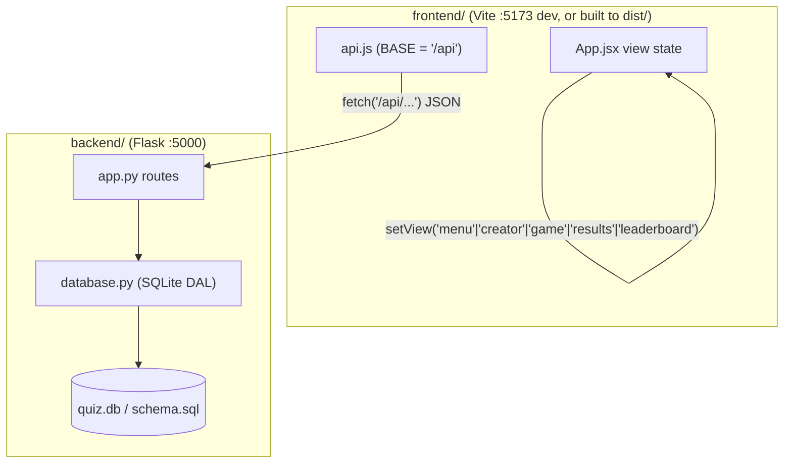

# Repository Guidelines

ACM "Guess the Output" — a quiz app where players read a short Python snippet and guess its output. Players answer, earn scores, and appear on a leaderboard; an admin creates/edits questions.

## Architecture & Data Flow

Two independent apps behind one contract:

- **Backend** (`backend/`): Flask + SQLite. Pure REST JSON API. Serves the built frontend in production.
- **Frontend** (`frontend/`): React 19 + Vite + Tailwind v4. Single-page app, no router library.



**Data flow**
1. `App.jsx` loads questions/stats/leaderboard on mount via `api.js`.
2. `api.js` calls relative `/api/*` endpoints. In dev, Vite proxies `/api` → Flask (`vite.config.js`); in prod Flask serves everything same-origin.
3. Backend handlers in `app.py` validate the body, then call `database.py`, which returns dicts.
4. Game state (`session`) lives in `App.jsx` and is passed down to `GamePage`; it is **not** persisted except via `/api/scores`.

**Routing is manual.** `App.jsx` holds a single `view` state string and swaps whole pages (`MenuPage`, `GamePage`, `CreatorPage`, `LeaderboardPage`, `ResultsPage`). No react-router. The only deep link is `/questions` → `view='creator'` (question editor). Navigate by calling `setView(...)`.

## Key Directories

| Path | Purpose |
|---|---|
| `backend/app.py` | Flask app: route table, validation helpers, prod SPA serving |
| `backend/database.py` | SQLite data-access layer (RLock-guarded, one connection per call) |
| `backend/schema.sql` | Tables: `questions`, `answers`, `scores` |
| `backend/quiz.db` | SQLite file (pre-seeded; `QUIZ_DB` env overrides path) |
| `backend/seed.py` | Inserts 6 sample questions if DB is empty |
| `backend/_e2e.py` | Hand-written urllib smoke/integration script (stdlib only) |
| `frontend/src/App.jsx` | Root: `view` state machine, session state, `init()` |
| `frontend/src/api.js` | `fetch` wrapper + typed endpoint methods |
| `frontend/src/pages/` | `MenuPage`, `CreatorPage`, `GamePage`, `LeaderboardPage`, `ResultsPage` |
| `frontend/src/components/` | `Y2kWindow`, `Dialog`, `ProgressBar`, `AnswerOption`, `Decorations` |
| `frontend/src/index.css`, `App.css` | Tailwind + Y2K CSS variables / theme |

## Development Commands

Backend:

```bash
cd backend && python app.py          # Flask on HOST:PORT (defaults 127.0.0.1:5000)
cd backend && python seed.py         # seed sample questions (no-op if DB non-empty)
cd backend && python _e2e.py         # smoke test — requires app.py running first
```

Frontend (in `frontend/`, after `npm install`):

```bash
npm run dev      # Vite dev server (:5173), proxies /api → Flask
npm run build    # → frontend/dist/ (served by Flask in prod)
npm run preview  # preview the built dist
npm run lint     # oxlint
```

Production: `npm run build` in `frontend/`, then `python backend/app.py`. Flask serves `frontend/dist` on the same origin; `/api` hits JSON routes, everything else is static/SPA fallback.

## Containerization (Docker)

Run the whole app — built frontend + Flask backend — behind one service:

```bash
docker compose up --build   # then open http://localhost:5000
```

- `Dockerfile` is multi-stage: `node:22-alpine` builds the frontend (`npm ci` → `npm run build`); `python:3.12-alpine` installs Flask and serves the built `frontend/dist` same-origin.
- `docker-compose.yml` exposes `5000:5000`, sets `HOST=0.0.0.0` (required for container reachability — the app defaults to `127.0.0.1`), and mounts a named volume `quiz-data` at `/app/backend/db` so questions/scores persist across `up`/`down`.
- `backend/entrypoint.sh` creates the DB, runs `seed.py` (idempotent) on a fresh volume, then `exec`s `app.py`.
- `DEBUG=0` by default (no reloader in the container); set `DEBUG=1` to enable Flask's reloader.
- `.dockerignore` keeps `node_modules`, `dist`, `__pycache__`, and the committed `quiz.db` out of the build context.

## Code Conventions & Common Patterns

**Backend (Python)**
- `from __future__ import annotations`; type-annotate signatures (`-> dict`, `list[str]`, `int`).
- Validation is centralized in two helpers in `app.py`:
  - `_json_body()` → raises `ValueError("Request body must be a JSON object.")` if body isn't a dict.
  - `_require(body, key)` → raises `ValueError("Missing required field: {key}")` if key missing or `None`/`""`.
- Error contract: every `ValueError` → **400** `{"error": str(exc)}`; missing record → **404** `{"error": "question not found"}`. Wrap handler logic in try/except to map `ValueError` → 400.
- DB layer (`database.py`): open a fresh connection per call (`_connect()`), set `row_factory = sqlite3.Row`, `PRAGMA foreign_keys = ON`, and guard all writes with the module `_lock` (`threading.RLock`). Close the connection in a `finally`.
- Correctness model: the API/DB stores answers with a per-answer `is_correct` boolean (`answers.is_correct`). The **create/update payload** uses a positional `correct_index` (0-based) that the backend converts to `is_correct`. `seed.py` also uses `correct_index`. Don't mix the two representations.
- Serialized shapes (from `Row`):
  - question → `{id, sort_order, snippet, created_at, answers:[{id, text, is_correct:bool, sort_order}]}`
  - score → `{id, player_name, score, correct_count, total_count, created_at}`

**Frontend (JSX)**
- `api.js` is the single API surface. Add endpoints as methods on the exported `api` object; never `fetch` directly elsewhere.
- The `request(path, options)` helper sets `Content-Type: application/json`, and **throws** `Error(data.error || ...)` on `!res.ok`. Callers use `try/finally` to manage `loading`/`error` state — keep that shape.
- Wire fields are **snake_case** (`correct_index`, `question_id`, `player_name`); JS/React props are camelCase. `api.js` is the translation boundary.
- State: plain `useState`/`useEffect` in `App.jsx`; `session` is lifted to the root and passed to child pages. No Redux/Zustand/RTK — keep it that way unless asked.
- Styling: Tailwind v4 via `@tailwindcss/vite`. Y2K theme lives in CSS variables + `.y2k-*` classes (`y2k-window`, `y2k-btn`, `y2k-bg`, `y2k-progress-fill`, `sparkle`, …). For new Y2K UI, see `retro_y2k_skill.md` / `retro_y2k_design.md` (design system + animation checklist), not memory.
- Hooks: `react/rules-of-hooks` is an **error**; `react/only-export-components` is a **warn** (constant exports allowed). Don't export non-component values from component files.

## Important Files

- `backend/app.py` — entry point; route table + validation + prod SPA serving
- `backend/database.py` — all SQLite access; the contract every route relies on
- `backend/schema.sql` — source of truth for the data model
- `frontend/src/App.jsx` — root view state + session + `init()`
- `frontend/src/api.js` — all network calls (single choke point)
- `frontend/vite.config.js` — `/api` proxy → `http://127.0.0.1:5000`
- `frontend/.oxlintrc.json` — lint rules
- `backend/requirements.txt` / `frontend/package.json` — dependencies
- `retro_y2k_skill.md` — installable design skill (trigger: "Y2K", "retro", "windows XP"); `retro_y2k_design.md` — canonical visual spec. Use both for any Y2K styling work.

## Runtime/Tooling Preferences

- **Python**: standard library only for runtime beyond Flask. DB is `sqlite3` (no driver). Deps: `flask>=3.0,<4.0`, `flask-cors>=4.0,<6.0` (`backend/requirements.txt`).
- **Node**: Vite 8 / React 19 / Tailwind v4. No `engines` field pins a version; in practice Node ≥ 20.19 / 22.9+ is needed for Vite 8. Package is ESM (`"type": "module"`).
- **Package manager**: npm (lockfile `frontend/package-lock.json`).
- **Env vars**: `PORT` (default `5000`), `HOST` (default `127.0.0.1`) in `app.py`; `QUIZ_DB` (default `<backend>/quiz.db`) in `database.py`.
- **Lint**: oxlint only (frontend). No backend linter configured.
- **Containerization**: `docker compose up --build` runs the whole app (see "Containerization (Docker)" section). No Makefile; local manual dev is still build-frontend-then-run-Flask.

## Testing & QA

- **No formal test framework.** No pytest, vitest, jest, or `test_*` files. No `test` npm script.
- **Only test artifact**: `backend/_e2e.py` — a plain-`urllib` smoke script run manually against a live server (`python backend/_e2e.py` after `python backend/app.py`). It prints status/payloads and ends with `print("E2E OK")`.
- **Caveats of `_e2e.py`**: no `assert` statements (a non-2xx won't fail the run), no DB isolation (mutates real `quiz.db`), and it assumes seed data exists (`qs[0]` raises `IndexError` on an empty table). It covers 7 of 11 routes.
- **Untested**: `GET /api/health`, `PUT /api/questions/<id>`, `DELETE /api/leaderboard`, the SPA catch-all, the entire `database.py` layer (only exercised indirectly), and the whole frontend. No validation/error-path or negative cases.

To add real coverage: `pytest` + Flask test client with an isolated temp DB, `assert` statements in `_e2e.py`, and (optionally) a `test` npm script (vitest) for the frontend.
